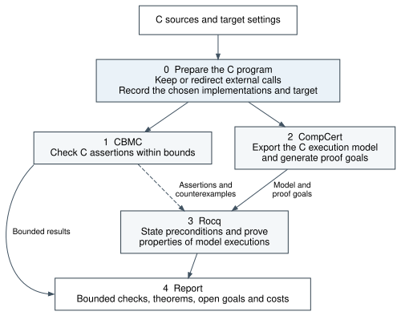

# FIVE

**Multi-level, bit-precise verification of floating-point C programs.**

FIVE combines traditional CBMC bounded model checking with CompCert's C semantics and Rocq proofs. It separates model generation from proof construction: exporting a model produces explicit proof obligations, while preconditions and proofs are supplied in a later proof task.



The diagram's editable source is [workflow.dot](docs/workflow.dot).

## Workflow

| Skill | Responsibility | Main outputs |
| --- | --- | --- |
| [five-prepare](.agents/skills/five-prepare/SKILL.md) | Freeze the source, target, dependencies and actual call bindings. | Prepared C and binding metadata. |
| [five-cbmc](.agents/skills/five-cbmc/SKILL.md) | Check the prepared C using traditional symbolic execution and bounded model checking. | Scoped properties, input assumptions, unwinding bounds and counterexamples. |
| [five-align](.agents/skills/five-align/SKILL.md) | Export CompCert models, audit their provenance, generate obligations and map C/CBMC properties to Rocq statements. | Models, pending goals, a separate precondition interface and property mappings. |
| [five-rocq](.agents/skills/five-rocq/SKILL.md) | Construct explicit preconditions and specifications, then prove the requested theorems. | Safety, termination, correspondence and functional proofs; independent CBMC-property reproofs or refutations. |
| [five-verify](.agents/skills/five-verify/SKILL.md) | Coordinate the stages, review their evidence and summarize results and costs. | Scoped conclusions, remaining obligations and deduplicated accounting. |

CBMC and CompCert consume the same prepared C program and use the recorded target settings. CBMC assertions and counterexamples can feed the property mapping for independent Rocq analysis. Rocq can also work directly with existing models.

## Walkthrough with `sum3`

[`examples/sum3`](examples/sum3/README.md) is currently at the **prepare** stage. The prepared [C program](examples/sum3/prepare/source/sum3.c) and [binding metadata](examples/sum3/prepare/source/bindings.json) are ready for the later CBMC and CompCert stages. No CBMC results, CompCert model or Rocq proof have been generated for this reconstruction.

The [case report](examples/sum3/prepare/report/report.md), [manifest](examples/sum3/prepare/report/manifest.json) and [cost record](examples/sum3/prepare/report/costs.json) describe the actual status and evidence. Later stages will add their own artifacts to the same case directory.

## Semantic scope

The current target is **CompCert 3.17, x86-64, Linux, little-endian, binary32, round-to-nearest ties-to-even**, including CompCert's NaN policy.

- Csyntax is generated by `clightgen -csyntax`; execution uses the installed, original `Csem`/`Cexec` definitions.
- Model entries retain arbitrary machine arguments and CompCert memory states. Proof preconditions do not restrict the execution model.
- Observations include result bit patterns, memory bytes, permissions and relevant traces. Reassociation or a different rounding sequence requires a separate equivalence argument.
- A function-level error is a state that is **not a normal return and has no legal Csem successor**. NaN, infinity and floating-point overflow are not automatically errors. Fuel exhaustion is not a proof of termination or an error diagnosis.
- External calls need explicit environment contracts. An unavailable callback is not evidence of C undefined behavior.

Theorems concern the stated CompCert semantics and their explicit assumptions. They do not automatically establish equivalence with GCC binaries or native hardware. Direct `vm_compute` execution is not required for relational proofs.

## Generated proof obligations

Every new model export creates:

```text
proof/
  Precondition.v   # Interface; the concrete precondition is pending.
  Obligations.v    # Automatically generated safety and termination propositions.
  Proofs.v         # Place for later proofs; no theorem is assumed proved.
```

`no_error_goal pre` quantifies over all reachable Csem states. `termination_goal pre` uses accessibility of the full successor relation, covering every execution branch without a fixed unwinding bound.

By default, the goals are parameterized by an unspecified precondition. A later proof task supplies the concrete predicate and proofs. Generation never fills the gap with `True`, `False`, an axiom or `Admitted`; regeneration preserves authored preconditions and proofs. See the [generator guide](scripts/generate-obligations.md).

## Examples and benchmarks

[`examples/sum3`](examples/sum3/README.md) is the standalone example, currently prepared for verification.

## Repository layout

`examples/sum3/` contains the four sequential stage directories `prepare/`, `cbmc/`, `align/`, and `rocq/`. The [example guide](examples/sum3/README.md) specifies their handoffs and current state. Shared semantic libraries are in `shared/`, workflow tools in `scripts/`, skills in `.agents/skills/`, and the manuscript in `paper/`.

## Example file structure

`examples/sum3/` contains `prepare/`, `cbmc/`, `align/`, and `rocq/` stage directories. The [sum3 guide](examples/sum3/README.md) lists what each stage reads and writes, including the current evidence and pending obligations.

## Working with the project

Use Linux or WSL with Python 3, Rocq 9.2 and CompCert 3.17 configured for the target above. CBMC is needed when running the implementation-checking stage. The toolchains are not bundled with this repository.

The local helper expects an existing opam switch named `five` and optionally tools in `.tools/`:

```sh
source scripts/env.sh
```

Export a model and its pending obligations:

```sh
python3 scripts/compcert-align.py export \
  --source examples/sum3/prepare/source/sum3.c --function f_sum3 \
  --namespace Sum3 --output _build/sum3
```

This generates and checks declarations; it does not construct the missing program proofs. For agent-driven stage accounting, attach the actual session with `--session /path/to/session.jsonl` and establish its boundary before authoring. A standalone tool replay does not measure prior model work.

After the model and proofs have been generated, the retained modules can be rebuilt and independently kernel-checked with:

```sh
python3 scripts/check-models.py
```

Final acceptance of execution correspondence and CBMC reproof evidence uses `scripts/compcert-verify.py gate`. Its [evidence contract](.agents/skills/five-verify/references/proof-evidence.md) distinguishes those checks from any additional safety, termination or functional theorem.

## Cost accounting

Each actual verification stage records real input/output tokens, wall time, tool CPU time and observed tool memory peaks. Cached input and reasoning output are subsets, not extra tokens. Retries, failures and timeouts are retained. End-to-end usage is deduplicated by event ID.

```sh
python3 scripts/audit-costs.py --run runs/<run-id>/<skill>
```

Missing or inconsistent evidence remains `partial`; it is never replaced with zero or an estimate. RSS sampling has explicit limits and excludes model-server memory. [Archived costs](reports/costs.json) retain their original measurement scopes and are not lifetime totals for each case. Repository maintenance is not a verification stage.

## Manuscript and provenance

The [paper draft](paper/README.md) and [PDF](paper/main.pdf) are retained alongside the unchanged original archive. Third-party notices remain with the source files. The [source-export record](reports/source-validation.json), [recorded module checks](reports/validation.json) and [library-interface inventory](reports/ast-library-audit.json) document their respective scopes.

The 2026-11-03 repository organization standardized the model entry filename as `Execution.v` and retained the four then-current cases. No CBMC or Rocq verification was run for that change. Recorded check logs and theorem output remain unchanged historical evidence, so they may contain former module names or cases. That historical record does not certify this fresh sum3 reconstruction, which currently has no model or proof. Archived cost records retain their original scopes, including earlier cases.

Corresponding artifacts share filenames across cases. Proof files share names when they serve the same role; case-specific lemmas and dependencies keep descriptive names. Missing proofs or licenses are not replaced with empty placeholders. Source renaming leaves C contents and generated ASTs unchanged; historical provenance retains original source paths. No verification was run for these naming changes.

The [executed sum3 comparison](paper/experiments/sum3/README.md) records WP and QCP runs, four kernel-checked arithmetic result-bit theorems, and matching CompCert/GCC native output bits for the two documented inputs. The evidence archive includes commands, source hashes, outputs and actual stage costs.
